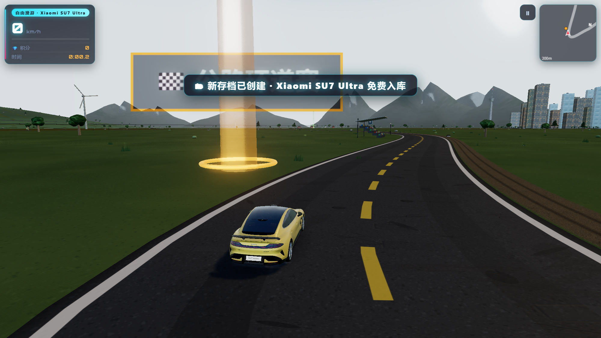
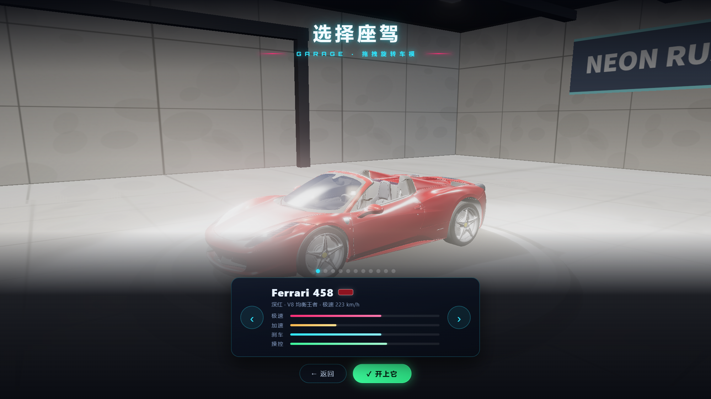
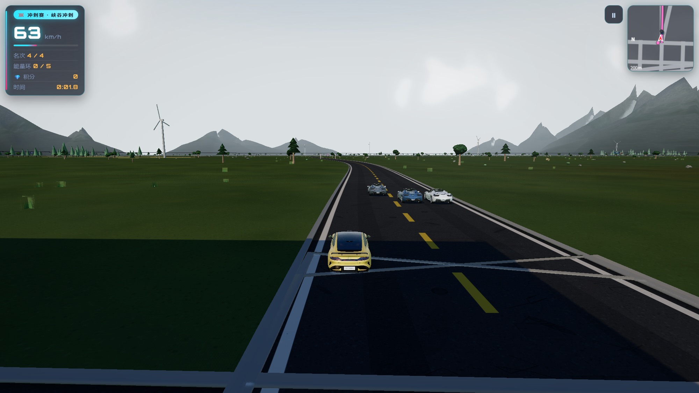
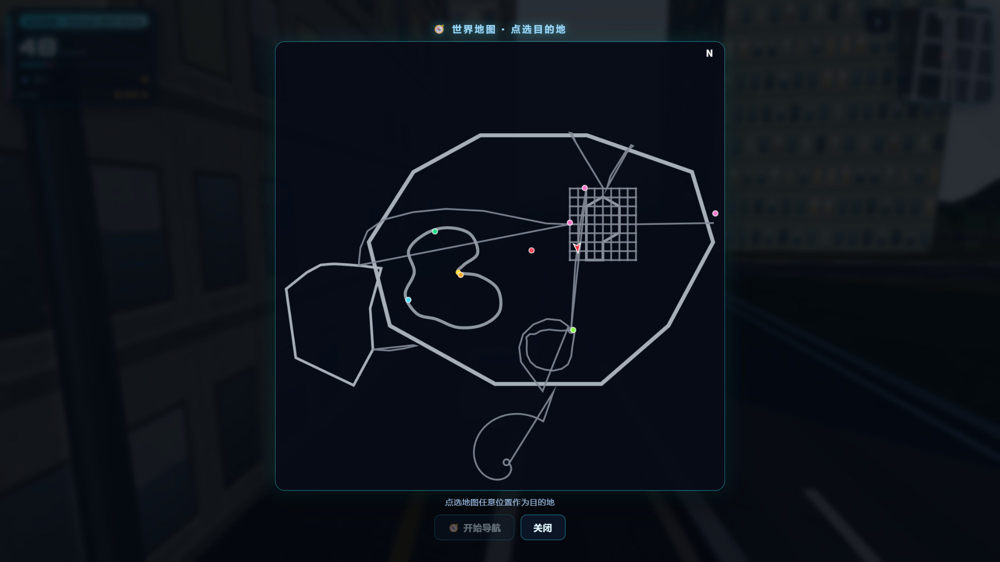

# 霓虹狂飙 NEON RUSH

一个用 **Three.js** 从零打造的开放世界赛车游戏——Forza 地平线式的大地图自由漫游：真实车模、动态天气、光柱赛事、积分经济，**电脑（WASD）与手机（陀螺仪）双端可玩**。

<p align="center">
  
</p>

---

## ✨ 游戏内容

### 🗺 开放世界（5200m × 5200m）
- **全连通路网**：高速环线（四车道）、城市街区 + 楼群、乡道土路、跨河大桥、盘山公路、湖泊与湖滨路——所有道路物理连通，无断头路
- **动态天气**：晴 / 多云 / 阴 / 雨自动轮换（每 80~150s），雨天路面湿滑、刹车距离变长
- **A* 路网导航**：长按小地图打开世界地图，点选任意目的地，3D 流光引导线带你去（偏航自动重算）

### 🚗 12 辆可驾驶车（全部真实 3D 车模）
| 车型 | 💎 售价 | 特点 |
|---|---|---|
| 小米 SU7 Max | 120 | 电驱起步王 |
| 小米 YU7 | 160 | 家庭 SUV，轻度越野 |
| Tesla Model S | 220 | 电动猛兽 |
| Jeep 牧马人 392 | 240 | **越野王**（草地保留 83% 极速） |
| BMW M2 (G87) | 280 | 纽北小钢炮 |
| BMW M4 | 340 | 直线悍将 |
| Porsche 911 | 460 | 弯道手术刀 |
| 小米 SU7 Ultra | 520 | 252km/h 全场最快 |
| Mercedes-AMG G63 | 640 | 方盒子猛兽 |
| Khronos 概念车 | 760 | 极速榜首 |
| **Ferrari 458** | **1000** | 镇店之宝 |

<p align="center">
  
</p>

### 💾 存档系统
- 最多 **3 个存档**（浏览器本地存储），支持继续 / 改名 / 删除
- 自动保存：比赛结算、购车、每 60 秒、回主菜单、关闭页面时
- 记录内容：车库、积分、里程、各赛事纪录、最近停车位置（读档回到原地上车）

### 💎 积分经济
- **跑图赚钱**：每开 1km = 1💎（所有模式都算）
- **比赛赚钱**：按名次发奖（冠军 100%、亚军 60%、季军 40%、完赛 20%）+ 首胜加成 + 破纪录翻倍
- **车店消费**：用积分购买新座驾（主菜单 / 暂停菜单均可进入）

### 🏁 赛事系统（Forza 式光柱报名，开到彩色光柱按 E 参赛）
| 赛事 | 类型 | 基础奖励 |
|---|---|---|
| 🏁 公路环道赛 | 3 圈对抗 3 名 AI | 60💎 |
| 🏁 高速冲刺 / 峡谷冲刺 / 海滨冲刺 | 点对点冲刺赛（检查点门） | 50~70💎 |
| 🌲 越野·湖东狂飙 | 野地拉力（**推荐越野车**） | 90💎 |
| ⏱ 单圈计时赛 | 冲击最速纪录 | 30💎（破纪录 ×2） |
| 🚀 直线加速赛 | 760m 计时 + 尾速 | 25💎（破纪录 ×2） |
| 💠 能量环收集 | 收集 14 个能量环 | 35💎 |

<p align="center">
  
</p>

---

## 🚀 快速开始

```bat
cd racing_game
start_server.bat
```

然后浏览器打开 **http://127.0.0.1:8010**

| 入口 | 用途 |
|---|---|
| `http://127.0.0.1:8010` | 本机游玩 |
| `http://<局域网IP>:8010` | 手机 / 平板（局域网内） |
| `https://<局域网IP>:8443` | **手机陀螺仪必须走此入口** |

> 手机陀螺仪需要 HTTPS 安全上下文，8443 端口使用自签证书——**首次访问需在浏览器中手动接受证书警告**。

## 🎮 操作

| 电脑 | 手机 |
|---|---|
| `WASD` / 方向键 驾驶 | 陀螺仪倾斜转向（主菜单开启，横竖屏皆可） |
| `空格` 手刹 | 左下 `BRAKE` 刹车 |
| `Esc` 暂停 | 右下 `▲` 油门，`AUTO` 定速巡航（锁当前速度） |
| `E` 报名比赛 | 开到光柱弹面板点「开始比赛」 |
| 短按小地图 切缩放 / 长按 打开世界地图点选导航 | 同左 |

<p align="center">
  
</p>

## ⚠️ 注意事项

1. **存档绑定浏览器**：存档存在浏览器 localStorage 里——换浏览器 / 清缓存 / 无痕模式都会丢失进度；同一台设备的同一浏览器最多 3 个档。
2. **手机刷新即更新**：改代码后手机端普通刷新即可（服务器带协商缓存，只有内容变化的文件才重新下载；车模较大，首次加载请耐心等待进度条）。
3. **陀螺仪权限**：iOS 需在 HTTPS 页面手动授权「动作与方向访问」；没开陀螺仪时手机无法转向（主菜单有提示）。
4. **性能**：桌面默认高特效（GTAO + Bloom + 4K 阴影），手机自动降档；低端设备可在主菜单切换「特效：低」。
5. **浏览器要求**：需支持 WebGL2 的现代浏览器（Chrome / Edge / Safari 15+）。
6. **本地模型**：车辆 GLB 模型在 `models/` 目录内随项目走，勿单独移动单个文件（源模归档在 `models/src/`，运行时不需要）。

## 🗂 项目结构（简）

```
├─ index.html      页面骨架 + 全部浮层 DOM
├─ css/style.css   HUD / 菜单 / 触屏按键
├─ js/             游戏核心（14 个模块：main 装配 / game 逻辑 / car 物理 / world 大世界 / save 存档 / economy 积分 …）
├─ models/         车模 GLB + Draco 解码器（src/ 为源模归档，不入库）
├─ tests/          puppeteer 回归测试（node tests/test_v232_systems.mjs 等）
├─ tools/          模型管线与诊断脚本
├─ docs/           开发文档（加车指南 ADD_CAR.md / 系统设计 DESIGN_GAME_SYSTEMS.md）+ README 截图
├─ serve.py        双端口静态服务器（8010 HTTP + 8443 HTTPS，协商缓存）
└─ start_server.bat
```

更多开发细节见 [AGENTS.md](AGENTS.md)（机制速查与避坑沉淀）。

## 🧪 开发者

```bash
npm install          # 安装 puppeteer-core
npm test             # 运行回归测试（需本机 Chrome + 先启动服务器）
node tests/test_v232_systems.mjs   # 存档/积分/车店/赛事 系统回归（25 断言）
node tools/tools_parse_acorn.mjs js/game.js   # ESM 语法冒烟
```
